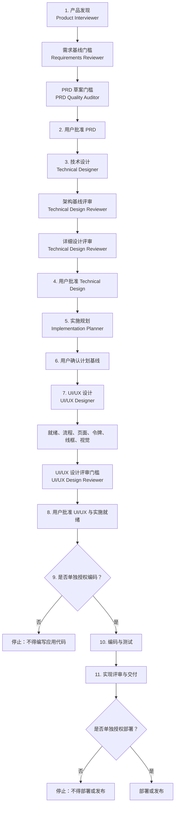

# Agent 主开发流程

> 版本：1.2.0  
> 状态：仓库级权威工作流  
> 适用对象：在本仓库工作的所有 AI 编码、规划、设计、评审和文档 Agent

## 1. 强制启动协议

**每个 Agent 在开始仓库工作前，都必须先阅读本文件和根目录的 `AGENTS.md`。** 随后：

1. 判断用户要求的结果，以及本次请求授权的是调研、文档、设计、规划、代码修改还是 GitHub 操作。
2. 阅读当前阶段的权威流程文件（见第 3 节）；必要时阅读已批准 PRD、Decision Log 及相关技术/设计文档。
3. 根据仓库文档和用户明确批准记录判断当前项目阶段。不得仅凭文件存在、前一个 Agent 的说法或评审状态推断阶段已获批准。
4. 明确当前阶段、已完成的门槛、缺失的前置条件，以及本次请求允许执行的工作。
5. 只执行当前阶段和用户请求授权范围内的工作，不得擅自推进到下一阶段。

如果用户明确要求执行后续阶段任务，必须先核实其前置条件。缺少前置条件或批准状态不明确时，应停在安全边界，提出一个关键澄清问题或说明缺失的审批门槛。不要无意义地重复已经完成的阶段。

## 2. 端到端开发生命周期

必须遵循以下顺序：

1. **Product Discovery（产品发现）**——明确用户需求、业务规则、MVP 范围、需求和验收标准。
2. **PRD Approval（PRD 批准）**——用户明确批准产品基线。
3. **Technical Design（技术设计）**——调研仓库，形成技术需求、架构、领域/数据/应用设计、安全、一致性、错误处理和测试策略。
4. **Technical Design Approval（技术设计批准）**——用户明确批准完整技术设计。
5. **Implementation Planning（实施规划）**——把已批准设计拆解为有顺序的 Epic/Task、依赖、里程碑和验证工作。规划不等于实施授权。
6. **Implementation Plan Review（实施计划审阅/基线确认）**——向用户呈现计划、依赖、风险和假设。只有用户明确确认后，才能将计划标记为已批准；Agent 生成计划本身不构成批准。
7. **UI/UX Design（界面与体验设计）**——PRD 和 Technical Design 已批准且实施计划存在后，依次完成就绪分析；信息架构、用户流程和页面清单；经用户确认的视觉方向；Design Tokens 和组件系统；线框、页面规格、高保真视觉及交互规格；设计系统/视觉验证和独立评审。
8. **UI/UX Approval & Implementation Readiness（UI/UX 批准与实施就绪）**——验证需求追溯、设计/技术一致性、设计系统符合性、评审 findings、无障碍/状态覆盖和计划对齐。用户明确批准设计及任何计划变更。
9. **Implementation Authorization（实施授权）**——必须另行取得用户明确的应用代码修改授权。PRD、Technical Design、Implementation Plan 或 UI/UX Design 获批都不代表编码授权。
10. **Coding & Testing（编码与测试）**——只实现已批准的范围和设计，并补充测试和验证。
11. **Implementation Review & Delivery（实现评审与交付）**——审查变更、验证验收标准、报告测试证据和限制。部署/发布仍需单独授权。

下面的流程图表示顺序。各阶段的操作步骤仍以第 3 节列出的阶段文件为准。英文版包含同一张图。

## 3. 各阶段权威文件与启动条件

| 阶段 | 权威说明 | 启动/进入条件 |
|---|---|---|
| Product Discovery | `docs/process/PRODUCT_DISCOVERY.md` | 用户要求探索/定义产品需求或行为 |
| Technical Design | `docs/process/TECHNICAL_DESIGN.md` | 用户已明确批准 PRD |
| Implementation Planning | `docs/process/TECHNICAL_DESIGN.md` 和 `docs/technical/10-implementation-plan.md` | 用户明确批准完整 Technical Design |
| UI/UX Design | `docs/process/UI_UX_DESIGN.md` | PRD、Technical Design 已批准，且实施计划已存在 |
| Coding & Testing | 已批准 PRD、Technical Design、Implementation Plan、UI/UX 文档及对应应用文档 | 用户另行明确授权实施 |

执行某一阶段前，必须完整阅读对应阶段文件及相关评审报告、决策记录，并遵循其中更严格的约束。

## 4. 全局治理规则

### 用户决策权与范围
- 产品行为、产品范围变更和审批由用户决定。
- 已批准 PRD 是产品范围的权威来源；已批准 Technical Design 是架构和技术契约的权威来源；已确认的实施/设计基线约束交付细节。
- 不得因为某项功能“有用”就擅自增加功能、角色、业务规则、页面、数据字段、集成或平台行为。
- 本项目 Version 1 已排除的范围继续排除，除非用户通过 Product Discovery 明确修改 PRD。尤其不得擅自增加身份验证/邮箱验证、多团队、跨设备同步、提醒、重复事件、全天事件，以及网站/管理后台/API 业务界面。
- 如果文档冲突，不得自行选择其一。应说明冲突、影响和所属阶段；涉及产品决策或范围变化时询问用户。
- 建议、假设、用户沉默、任务完成和 Reviewer findings 均不构成用户批准。

### Agent 角色与评审
- 当前阶段的主 Agent 是唯一面向用户的协调者；在获准时负责正式文档修改、findings 处理和用户沟通。
- Reviewer 是独立只读角色，只返回 findings；不得修改正式文档、替用户做产品决策、访谈用户或编写实现代码。
- 只在阶段文件定义的 Gate 调用 Reviewer，不得每轮对话都调用。
- 平台支持时使用真正的只读/沙箱权限。提示词中写“不要修改”并不能阻止工具写入。
- 平台不支持原生 subagent 委派时必须披露。自检只能作为 fallback，不得描述成独立评审。
- Findings 应包含严重程度、证据/来源、场景、影响、建议及是否需要用户决策。重大 findings 必须在通过 Gate 前解决、明确接受或跟踪；重大修改后重新评审。

### 授权与修改边界
- 调研、规划、设计和评审都不授权修改应用代码。
- 除非当前任务明确授权，不得安装依赖、修改应用源码、调整 CI/部署、访问生产环境、部署、发布或修改云资源。
- 不得在低权威阶段擅自修改高权威文档。例如 UI/UX 不得暗中改变 PRD 行为或 Technical Design 契约；实现阶段不得自行重定义已批准设计。
- 如果低阶段产物要求修改上游内容，应记录建议变更，并通过所属工作流和用户审批处理。
- 未经用户明确授权，不得 commit、push、merge 或 release。不得直接 push 到 main 或 force-push；应使用独立分支和 PR。

### 设计质量与项目适用范围
- 本生命周期和每个阶段文件适用于本仓库的每个产品和项目，也适用于所有由本仓库启动的新项目。本仓库之外的项目通过 `docs/ui-ux/PROJECT-ADOPTION-CHECKLIST.md` 采用。
- 每条设计约束都要归类为范围（Scope，来自已批准的 PRD 或 Technical Design）或品味（Taste，视觉偏好）。只有范围约束才约束后续重设计。用户可以通过批准替换方案来取代品味约束。见 `docs/process/UI_UX_DESIGN.md` 第 4A 节。
- 视觉质量以渲染结果为准：窄视口和宽视口的截图，以及测量得到的对比度。Token 校验、lint、类型检查、测试和文字描述是必要的，但永远不能证明视觉质量。缺少渲染证据属于 NOT RUN，不是 PASS。
- 项目不得跳过或削弱阶段文件的要求，除非有用户已批准并记录的偏差。

## 5. Gate 与批准状态

阶段 Gate 表示该阶段的进入条件和评审工作已完成，**不代表用户已批准产物**。

文档使用明确状态：
- `DRAFT`——进行中。
- `READY FOR REVIEW` / `READY FOR USER REVIEW`——已提交审阅，尚未批准。
- `APPROVED`——仅在用户明确批准后使用；适用时记录批准人/上下文/日期。
- `BLOCKED`——前置条件、决策或 Critical finding 阻止安全推进。
- `NOT AUTHORIZED`——该操作（尤其编码、部署、发布）尚未获得授权。

不得从文档 PR 已合并、Reviewer PASS 或 Agent 声称完成推断 `APPROVED`。以下状态必须区分：
- PRD：产品行为/范围批准。
- Technical Design：架构/技术契约批准。
- Implementation Plan：任务顺序/实施基线确认。
- UI/UX Design：呈现/交互设计批准。
- Implementation：单独明确授权修改应用代码。

## 6. Agent 开始与完成任务时的要求

开始任务时，应判断并在适当时向用户说明：用户要求的结果、当前生命周期阶段、已完成的前置审批和 Gate、本次任务范围，以及明确不在本次授权范围内的操作。

完成任务时，应报告修改的文件/产物、用户决策与 Agent 建议/假设的区别、已完成和未完成的 Gate/评审及剩余 findings、实际执行的验证及结果、下一合法阶段及所需用户批准，以及重要的未执行事项。

没有对应工具证据时，不得声称独立评审、测试、运行时验证或 Git 操作成功。

## 7. 仓库语言约定

除非文件另有说明，英文工作流文档为权威版本。中文 `-zh.md` 文件为翻译版本，必须保持语义一致。修改存在中文版本的权威工作流时，应在同一变更中同步更新中文翻译。

## 8. 流程维护规则

新增或修改生命周期阶段、Gate、Agent 角色或授权边界时：
1. 首先更新本权威流程文件。
2. 更新受影响的阶段专属流程和角色定义。
3. 只有在启动说明或全局约束改变时才更新 `AGENTS.md`。
4. 生命周期顺序变化时更新本文件中的流程图。
5. 更新中文翻译，包括其中的流程图。
6. 检查 README 链接和引用是否一致。
7. 设计质量 Gate 发生变化时，同步更新 `docs/ui-ux/ENGINEERING-STANDARD.md`、`docs/ui-ux/PROJECT-ADOPTION-CHECKLIST.md`，以及 `.claude/`、`.cursor/`、`.codex/`、`.agents/` 下所有角色和 skill 镜像。

不要在 `AGENTS.md` 重复完整阶段流程。它应作为强制入口和全局护栏；本文件是仓库唯一的主生命周期规范。
