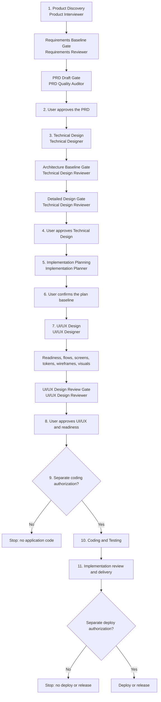

# Agent Development Workflow

> Version: 1.1.0  
> Status: Canonical repository-wide agent workflow  
> Audience: Every AI coding, planning, design, review, and documentation agent working in this repository

## 1. Mandatory startup protocol

**Every agent must read this file and the root `AGENTS.md` before doing repository work.** Then:

1. Identify the user's requested outcome and whether the request authorizes analysis, documentation, design, planning, code changes, or GitHub operations.
2. Read the canonical workflow document for the active stage (see §3), the approved PRD and decision log when relevant, and applicable technical/design artifacts.
3. Determine the current project stage from repository artifacts and explicit user approvals—not from assumptions, file existence, a previous agent's claim, or review status alone.
4. State the current stage, completed gates, missing prerequisites, and the work permitted by the user's request.
5. Execute only the requested work within the current stage. Do not silently advance to another stage.

If a user explicitly requests a later-stage task, verify its prerequisites first. If prerequisites are missing or approval is unclear, stop at the safe boundary and ask one focused question or propose the missing gate. Do not repeat completed stages unnecessarily.

## 2. End-to-end lifecycle

The required lifecycle is:

1. **Product Discovery** — establish user needs, business rules, MVP scope, requirements, and acceptance criteria.
2. **PRD approval** — the user explicitly approves the product baseline.
3. **Technical Design** — inspect the repository, establish technical requirements, architecture, domain/data/application design, security, consistency, error handling, and test strategy.
4. **Technical Design approval** — the user explicitly approves the complete technical design.
5. **Implementation Planning** — convert the approved design into sequenced epics/tasks, dependencies, milestones, and verification work. Planning is not implementation authorization.
6. **Implementation Plan review / baseline confirmation** — present the plan, dependencies, risks, and any assumptions for user review. Do not treat a generated plan as approved unless the user explicitly confirms it.
7. **UI/UX Design** — after approved PRD and Technical Design and an available implementation plan: readiness analysis; information architecture, user flows, and screen inventory; user-approved visual direction; token and component system; wireframes, page specifications, high-fidelity visuals, and interaction specifications; visual/design-system validation; independent review.
8. **UI/UX approval and implementation readiness** — verify requirement traceability, design/technical consistency, visual-system compliance, review findings, accessibility/state coverage, and plan alignment. The user explicitly approves the design and any plan changes.
9. **Implementation authorization** — obtain separate, explicit user authorization to write application code. Approval of the PRD, Technical Design, Implementation Plan, or UI/UX Design is not coding authorization.
10. **Coding & Testing** — implement only the approved scope and design, with tests and verification.
11. **Implementation review and delivery** — review changes, verify acceptance criteria, report test evidence and limitations. Deploy/release only with separate authorization.

The flowchart below is the order. Stage procedures stay in the stage documents named in section 3. The Chinese translation carries the same chart.

## 3. Canonical stage documents and activation

| Stage | Canonical instructions | Activation / entry condition |
|---|---|---|
| Product Discovery | `docs/process/PRODUCT_DISCOVERY.md` | User asks to explore/define product requirements or behavior |
| Technical Design | `docs/process/TECHNICAL_DESIGN.md` | PRD explicitly approved by user |
| Implementation Planning | `docs/process/TECHNICAL_DESIGN.md` and `docs/technical/10-implementation-plan.md` | Complete Technical Design explicitly approved |
| UI/UX Design | `docs/process/UI_UX_DESIGN.md` | PRD and Technical Design approved; implementation plan exists |
| Coding & Testing | Approved PRD, Technical Design, Implementation Plan, UI/UX package, plus applicable app/package docs | User separately authorizes implementation |

Read the relevant stage document in full before executing that stage. Also read the corresponding review reports and decision records. Follow any more restrictive stage-specific constraint.

## 4. Universal governance rules

### User authority and scope
- The user owns product behavior, scope changes, and approval decisions.
- Approved PRD is the source of truth for product scope. Approved Technical Design is the source of truth for architecture and technical contracts. The approved implementation/design baselines govern delivery details.
- Never add features, actors, business rules, screens, data fields, integrations, or platform behavior merely because they seem useful.
- This project's Version 1 exclusions remain excluded unless the user explicitly changes the PRD through Product Discovery. In particular, do not introduce authentication/email verification, multi-team, cross-device sync, reminders, recurring events, all-day events, or website/admin/API business surfaces.
- If artifacts conflict, do not silently choose one. Identify the conflict, its impact, and the owner stage; ask the user when a product decision or scope change is required.
- Recommendations, assumptions, silence, task completion, and reviewer findings are not user approval.

### Agent roles and review
- The primary agent for the active stage is the sole user-facing orchestrator. It owns canonical document edits when authorized, findings triage, and user questions.
- Reviewers are independent, read-only roles. They return findings only; they do not edit canonical artifacts, make product decisions, interview the user, or implement.
- Invoke reviewers at defined gates in the relevant stage document, not on every turn.
- Use actual platform-level read-only/sandbox controls where available. Prompt instructions alone do not prevent tool writes.
- If native subagent delegation is unavailable, disclose that limitation. A self-review is only a fallback and must never be represented as independent review.
- Classify findings by severity, evidence/source, scenario, impact, recommendation, and whether user decision is required. Resolve, explicitly accept, or track material findings before passing a gate. Re-review material changes.

### Authorization and change boundaries
- Analysis, planning, design, and review do not authorize application code changes.
- Do not install dependencies, modify application source, alter CI/deployment, access production, deploy, release, or change cloud resources unless the current task explicitly authorizes that action.
- Do not edit a higher-authority artifact from a lower-authority stage. For example, UI/UX cannot silently change PRD behavior or Technical Design contracts; implementation cannot silently redefine approved designs.
- If a lower-stage artifact requires an upstream change, document the proposed delta and route it through the owning workflow and user approval.
- Do not commit, push, merge, or release unless the user explicitly authorizes the relevant Git operation. Never push directly to main or force-push; use a focused branch and PR.

## 5. Gate and approval semantics

A stage gate means its documented entry criteria and review work are complete. It does **not** mean the user has approved the resulting artifact.

Use explicit statuses in documents:
- `DRAFT` — work in progress.
- `READY FOR REVIEW` / `READY FOR USER REVIEW` — presented for review; not approved.
- `APPROVED` — only after explicit user approval, with approver/context/date recorded where the artifact's convention supports it.
- `BLOCKED` — a prerequisite, decision, or critical finding prevents safe progress.
- `NOT AUTHORIZED` — the action (especially coding, deployment, release) has not been authorized.

Never infer `APPROVED` from a merged documentation PR, a reviewer PASS, or an agent's completion message. Keep these distinct:
- PRD: product behavior/scope approval.
- Technical Design: architecture/technical contract approval.
- Implementation Plan: task sequencing/baseline confirmation.
- UI/UX Design: presentation/interaction approval.
- Implementation: separate explicit authorization to modify application code.

## 6. How to respond when starting or finishing work

At task start, internally establish and, when useful, tell the user:
- requested outcome;
- current lifecycle stage;
- prerequisite approvals and completed gates;
- scope of this task;
- actions explicitly out of scope.

At task completion, report:
- artifacts/files changed;
- decisions made by the user versus recommendations/assumptions;
- gates/reviews completed and remaining findings;
- verification actually run and its results;
- next valid stage and any required user approval;
- actions not taken (for example, no code, no dependency installation, no merge) when material.

Do not claim independent review, tests, runtime validation, or successful Git operations without corresponding tool evidence.

## 7. Repository language convention

English workflow documents are canonical unless an artifact explicitly says otherwise. Chinese `-zh.md` documents are translations and must remain semantically aligned. When changing a canonical workflow, update its Chinese translation in the same change where one exists.

## 8. Maintenance rule

When adding or changing a lifecycle stage, gate, agent role, or authorization boundary:
1. Update this canonical workflow first.
2. Update the affected stage-specific workflow and role definitions.
3. Update `AGENTS.md` only if its startup instructions or global constraints change.
4. Update the flowchart in this file when the lifecycle order changes.
5. Update the Chinese translation, including its flowchart.
6. Check README links and references for consistency.

Do not duplicate full stage procedures in `AGENTS.md`. Keep it as the mandatory entry point and global guardrail; this file is the single repository-wide lifecycle authority.
