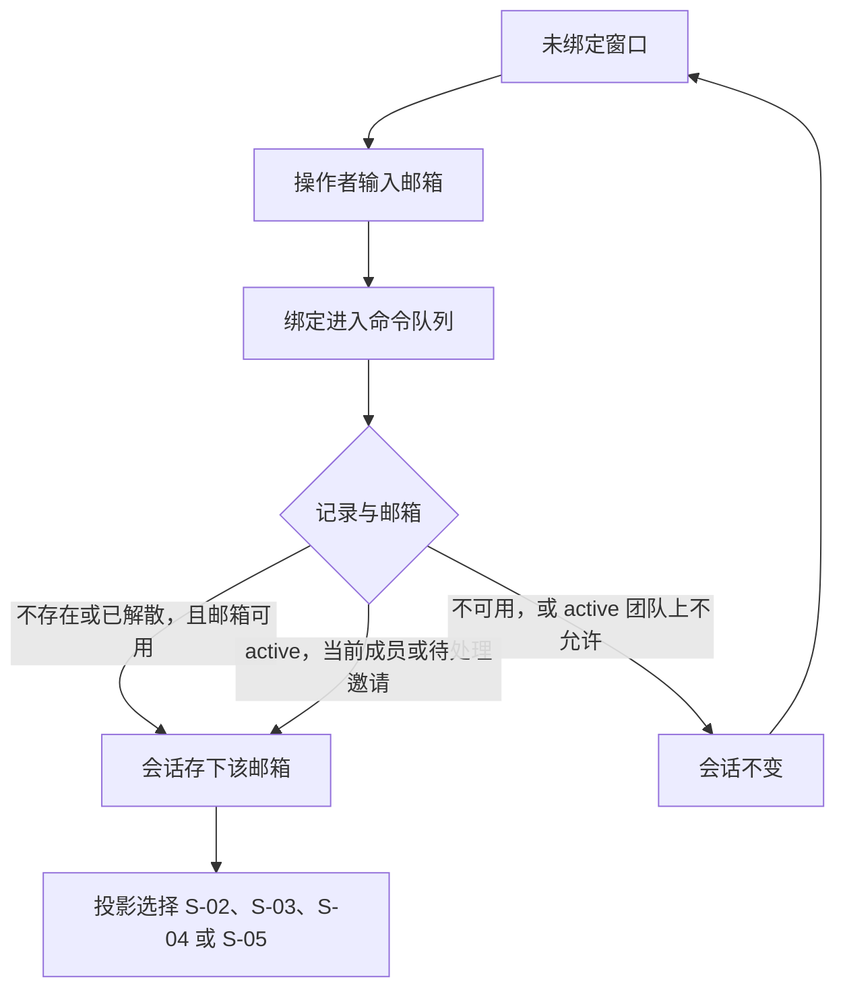
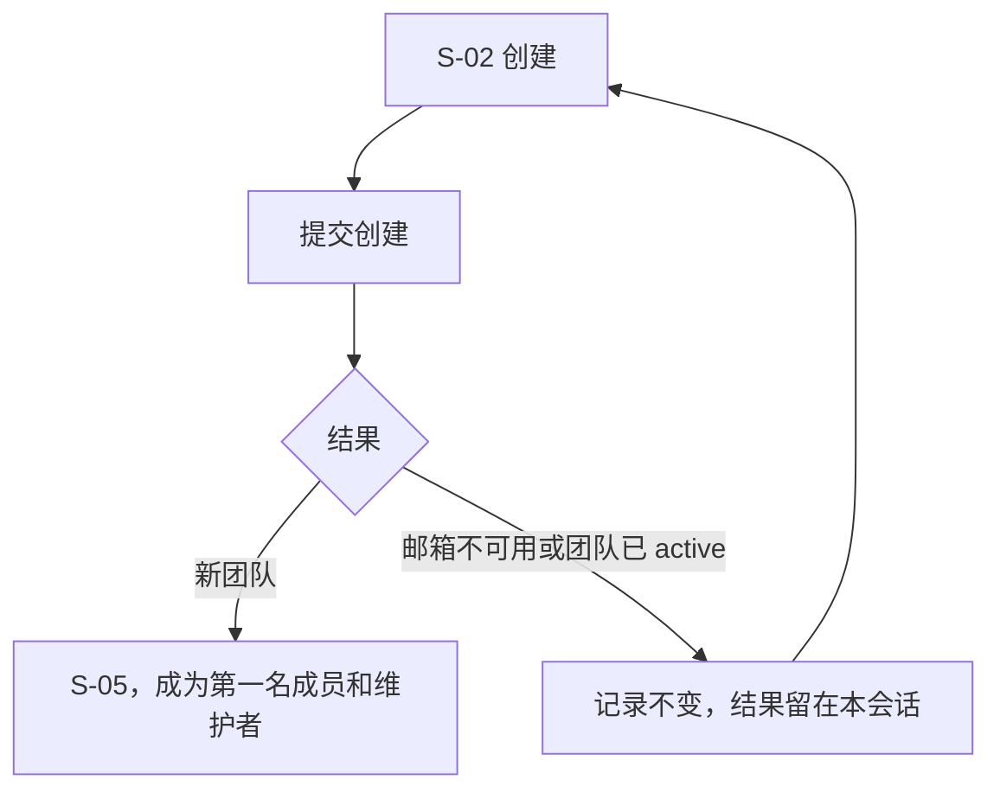
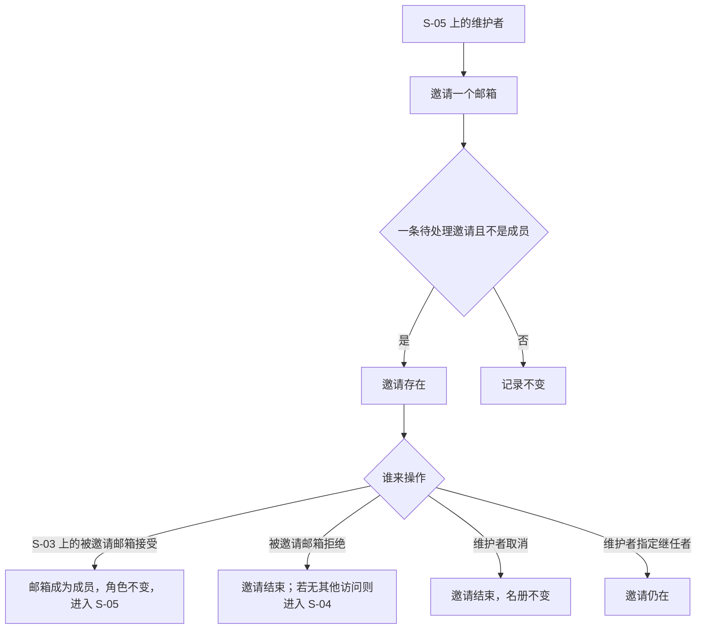
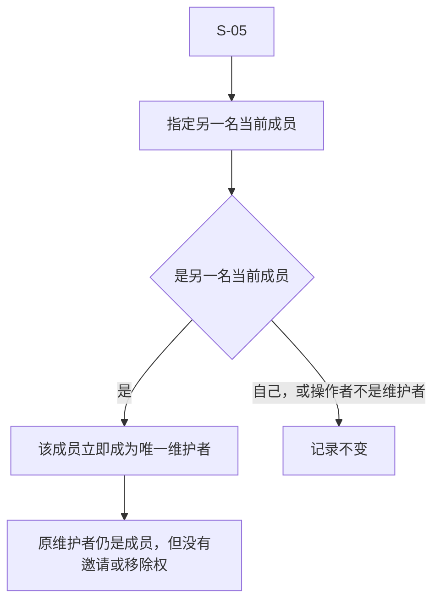
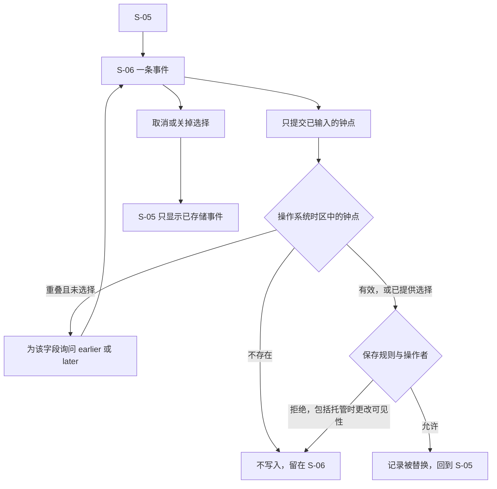
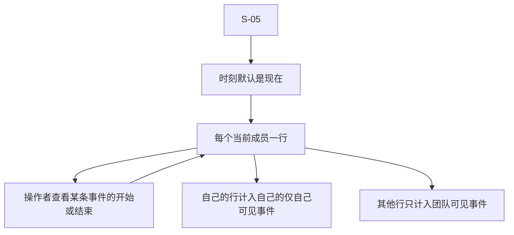
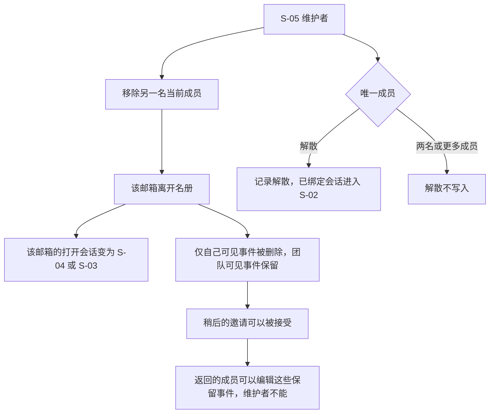
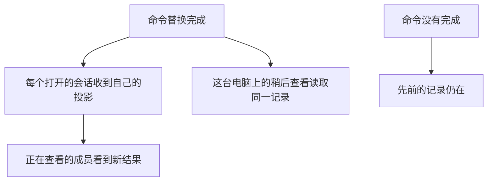
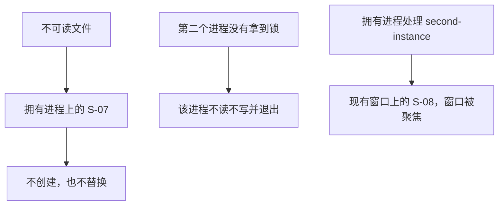

# 用户流程

- 阶段：1 — 信息架构、用户流程和页面清单
- 日期：2026-11-20
- 状态：用户于 2026-11-20 连同结构基线一并接受。流程不增加业务规则。
- 领域拒绝的步骤返回同一记录。窗口把结果码显示给发出命令的会话。其他会话看不到未提交字段。
- Implementation Plan 只作为顺序参考。
- 英文 `02-user-flows.md` 是规范文本。本文件是对照译文。图中的步骤名称与英文稿对应。

## F-01 绑定本会话

- 操作者：这台电脑前的操作者。
- 进入：没有绑定邮箱的窗口，包括由“再开一个会话”打开的窗口。
- 离开：会话存下规范邮箱，或保持未绑定。
- 页面：S-01。新窗口未绑定，从 S-01 开始。

追溯：TD-002。通过选择窗口所代表的邮箱，支撑 AC-004、AC-015 和 AC-019。绑定不写入团队记录。

## F-02 创建团队

- 操作者：记录为 absent 或 dissolved 时的已绑定邮箱。
- 进入：S-02。
- 离开：新的 active 团队，以及该邮箱的 S-05；或者 S-02 保持不变。
- 创建命令不发送邮箱。它使用已绑定邮箱。

追溯：BR-1、AC-001、AC-002、AC-003、AC-050。记录已经 active 时的失败路径是 AC-002。该窗口不在 S-02。

## F-03 邀请

- 操作者：S-05 上的当前维护者；S-03 上的被邀请邮箱。
- 进入：维护者提交一个邮箱，或被邀请会话绑定到该邮箱。
- 离开：一条待处理邀请、一名新成员，或邀请被移除。被拒绝的命令不改变邀请和名册。

追溯：BR-2、BR-3、AC-004 到 AC-008、AC-030、AC-032 到 AC-036。S-03 只显示该待处理地址，不显示名册、事件或忙闲。接受后，S-05 显示已有的团队可见事件，包括已结束事件和加入前创建的事件。

## F-04 指定维护者

- 操作者：当前维护者。
- 进入：S-05 的维护者区域，选择另一名当前成员。
- 离开：该成员成为唯一维护者，或记录不变。

追溯：BR-3、AC-009、AC-038、AC-039。AC-008 仍然成立：指定继任者不结束待处理邀请。

## F-05 一条事件

- 操作者：当前成员处理自己的事件。维护者只在所有者已不是当前成员时，编辑保留的团队可见事件的文字或时间，或删除它。
- 进入：S-05 为创建或为一条可见事件 id 打开 S-06。
- 离开：命令成功后 S-05 显示已存储事件；拒绝、取消或关掉发生次数选择后，已存储事件不变。

追溯：BR-4、BR-5、DEC-006、AC-012 到 AC-015、AC-020、AC-021、AC-028、AC-029、AC-037、AC-043 到 AC-051。AC-046 是取消和失败保存的离开路径。时区不是表单字段。开始和结束都重叠时，结果先指出开始。

## F-06 忙闲与可见事件

- 操作者：当前成员。
- 进入：S-05。
- 离开：同一工作区的另一个时刻，或打开操作者可以打开的事件的 S-06。
- 忙闲板对正在查看的时刻调用 `busyAt`。它不保留第二套规则。

追溯：BR-6、AC-016 到 AC-018、AC-040、AC-041、AC-042、AC-045。AC-042 的标签按 C-01 方案 A 使用一个操作系统时区。是否忙碌的一致判断仍使用绝对时刻。已移除的所有者没有行。该所有者保留的团队可见事件仍在事件列表中，并带有已存储的所有者邮箱。

## F-07 移除、重新加入和解散

- 操作者：维护者；被移除邮箱的打开会话；稍后被邀请的会话；唯一成员。
- 进入：S-05。
- 离开：被移除的会话离开 S-05；稍后接受邀请后以所有者权利回到 S-05；唯一成员解散后，因为记录已解散而到达 S-02。

追溯：BR-3、BR-5、AC-010、AC-011、AC-019 到 AC-023、AC-026、AC-031、AC-041、AC-047 到 AC-049。AC-026 和 AC-031 以先完成的命令为准。窗口显示已完成命令的结果。不需要确认目的地。

## F-08 已完成的变更变为可见

- 操作者：一个正打开的会话，以及一个稍后查看的会话。
- 进入：命令通过替换本地记录而完成。
- 离开：这台电脑上每个打开的会话收到自己的新投影。之后打开的会话读取当前记录。

追溯：BR-7、TD-001、AC-024、AC-025、AC-035、AC-046。另一名成员是另一个本地会话或稍后查看。Version 1 不在另一台电脑上显示该记录。

## F-09 不可读记录与第二个进程

- 操作者：操作者。
- 进入：文件存在但不是有效的 version 1 文档，或第二个进程启动。
- 离开：不从损坏文件创建新团队。第二个进程不会变成带有目的地的窗口。

追溯：BR-7，以及已批准的锁和 `record-unreadable` 行为。没有单独的验收编号。AC-027 没有流程：事件开始或邀请创建时，产品不显示提醒。

## 验收覆盖

| 标准 | 流程 | 页面 |
|---|---|---|
| AC-001、AC-003、AC-050 | F-02 | S-02 到 S-05 |
| AC-002 | F-02 | 不是 S-02；失败显示在尝试创建的会话上 |
| AC-004、AC-005、AC-006、AC-007、AC-008、AC-030、AC-032、AC-033、AC-034、AC-035、AC-036 | F-03 | S-03 和 S-05 |
| AC-009、AC-038、AC-039 | F-04 | S-05 |
| AC-010、AC-011、AC-019、AC-020、AC-021、AC-022、AC-023、AC-026、AC-031、AC-041、AC-047、AC-048、AC-049 | F-07 | S-05，然后是 S-04、S-03 或 S-02 |
| AC-012、AC-013、AC-014、AC-015、AC-028、AC-029、AC-037、AC-043、AC-044、AC-046、AC-051 | F-05 | S-06 |
| AC-016、AC-017、AC-018、AC-040、AC-042、AC-045 | F-06 | S-05 |
| AC-024、AC-025 | F-08 | 已打开会话的当前目的地 |
| AC-027 | 无 | 没有提醒表面 |
| AC-044 保存后的可见性 | F-05 然后 F-06 | S-06 然后 S-05 |

AC-015 是 S-03 或 S-04 上的操作者没有能写入的创建事件操作。AC-020 留在 S-06；托管编辑若包含可见性变更，则不写入。
