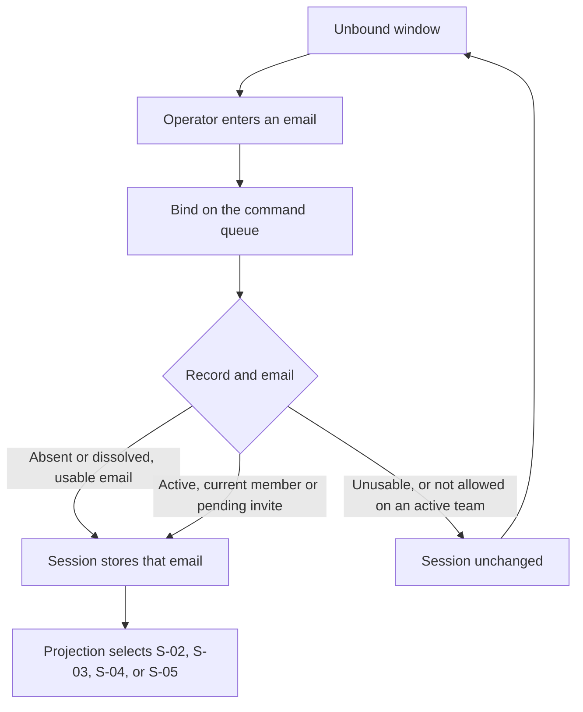
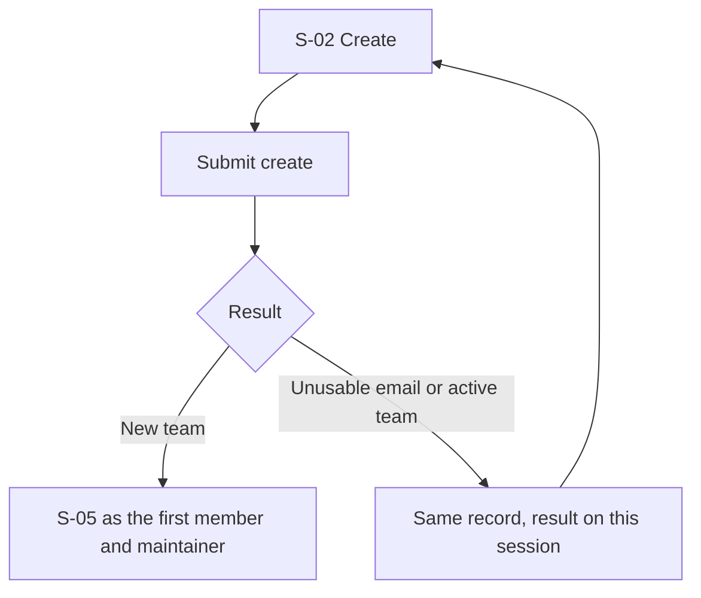
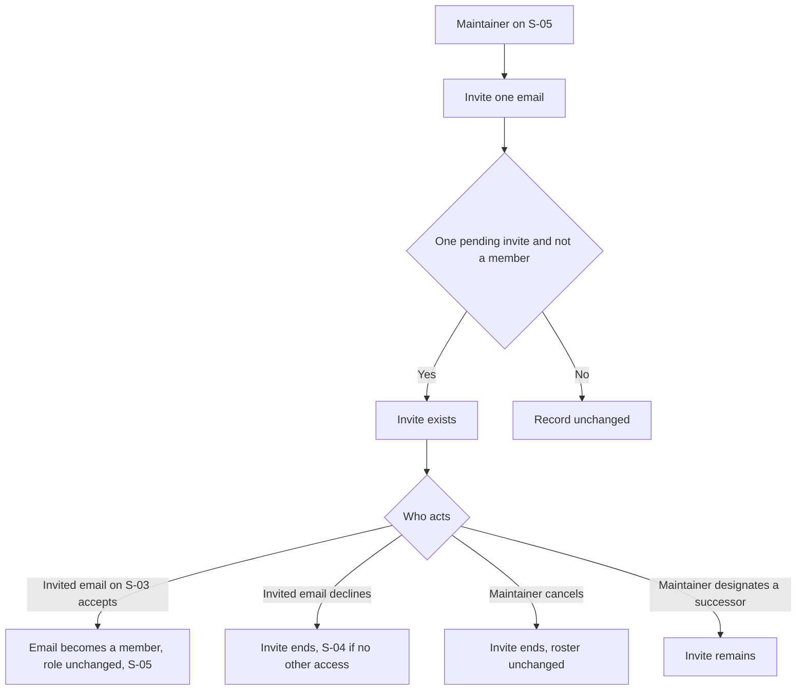
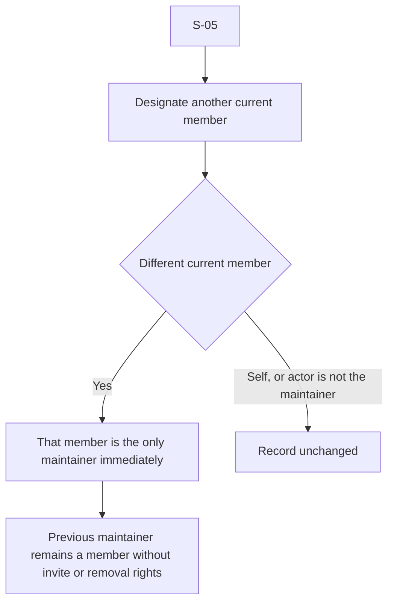
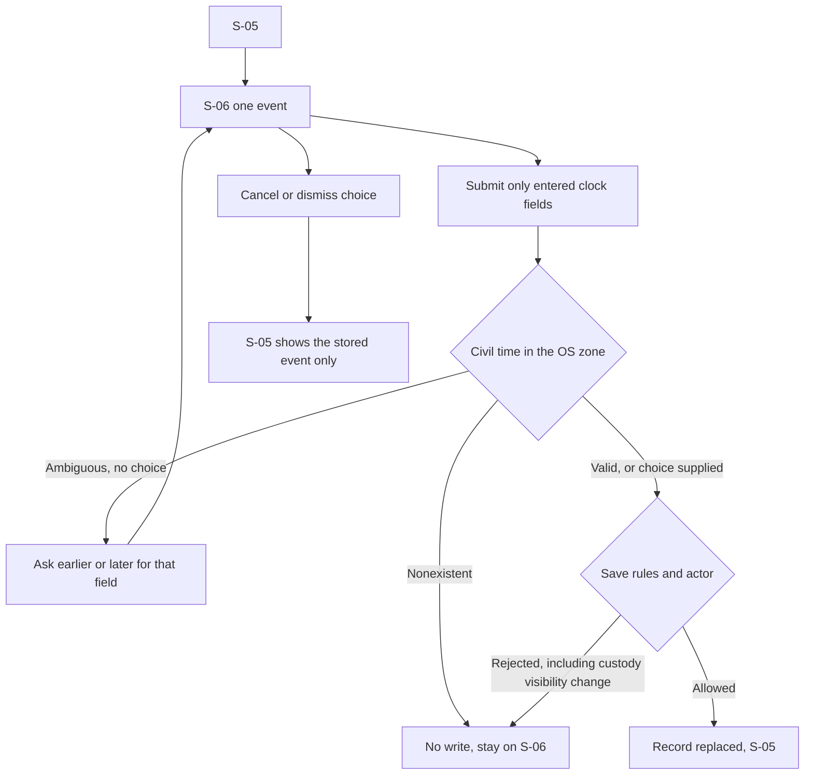
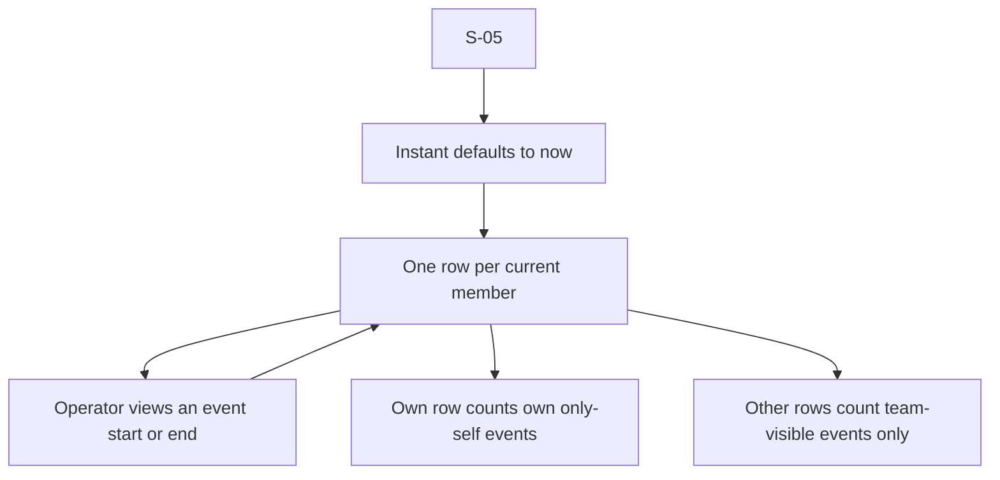
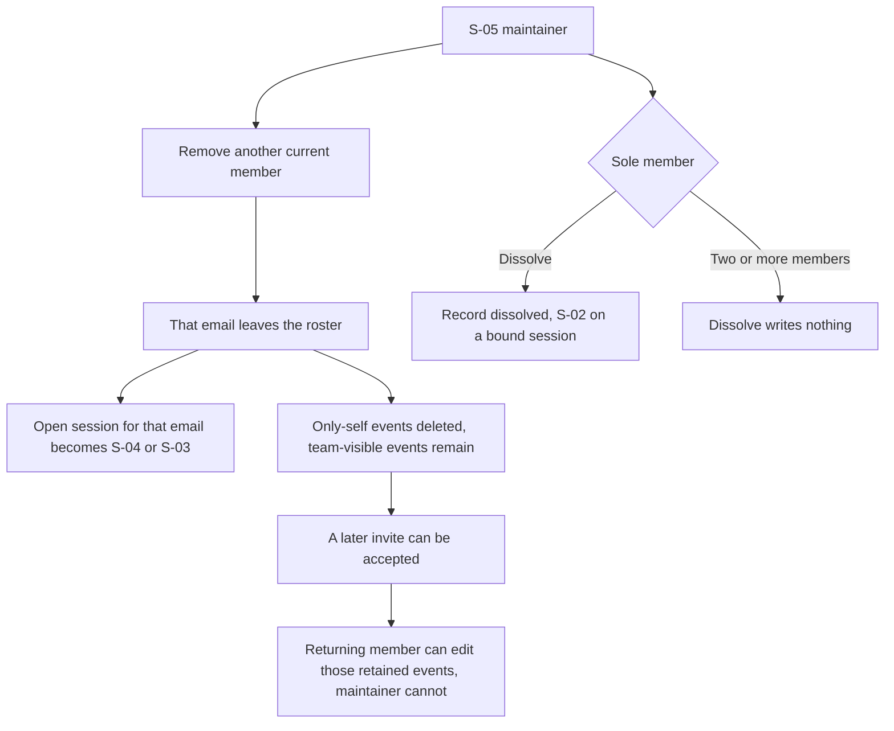
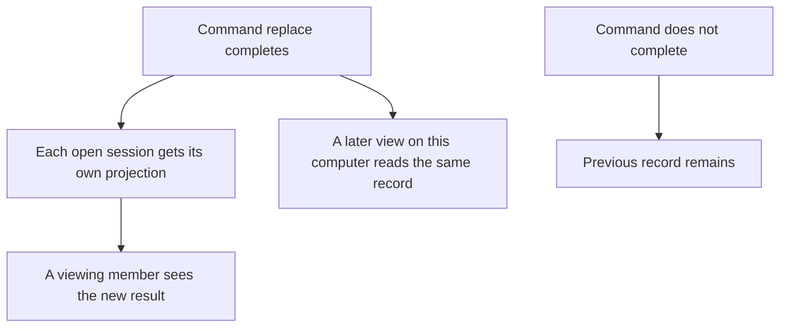
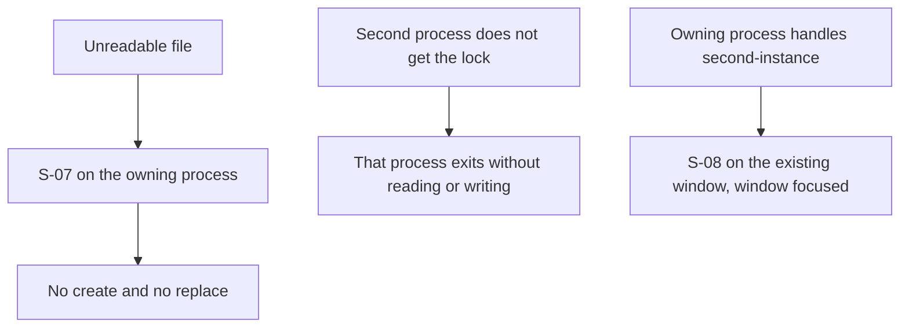

# User Flows

- Stage: 1 — Information Architecture, User Flows, and Screen Inventory
- Date: 2026-11-20
- Status: Accepted by the user on 2026-11-20 with the structural baseline. Flows add no business rule.
- A flow step that the domain rejects returns the same record. The window shows the result code to the session that issued the command. Other sessions do not see unsent fields.
- The Implementation Plan is a sequencing reference only.

## F-01 Bind this session

- Actor: operator at this computer.
- Entry: a window with no bound email, including a window opened by `open another session`.
- Exit: the session stores a canonical email, or it stays unbound.
- Screens: S-01. A new window is unbound and starts at S-01.

Trace: TD-002. Supports AC-004, AC-015, and AC-019 by choosing which email the window is. Binding does not write the team record.

## F-02 Create the team

- Actor: bound email while `record` is absent or dissolved.
- Entry: S-02.
- Exit: a new active team and S-05 for that email, or S-02 unchanged.
- The create command sends no email. It uses the bound email.

Trace: BR-1, AC-001, AC-002, AC-003, AC-050. AC-002 is the failure path when the record is already active. That window is not on S-02.

## F-03 Invitation

- Actors: current maintainer on S-05; invited email on S-03.
- Entry: maintainer submits one email, or the invited session is bound to that email.
- Exit: one pending invite, a new member, or the invite removed. A rejected command leaves the invite and roster unchanged.

Trace: BR-2, BR-3, AC-004 through AC-008, AC-030, AC-032 through AC-036. S-03 shows that pending address and no roster, events, or busy/free. After accept, S-05 shows existing team-visible events, including events that ended and events created before the join.

## F-04 Maintainer designation

- Actor: current maintainer.
- Entry: S-05 maintainer region, choosing a different current member.
- Exit: that member is the only maintainer, or the record is unchanged.

Trace: BR-3, AC-009, AC-038, AC-039. AC-008 continues to hold: designation does not end a pending invite.

## F-05 One event

- Actor: any current member reads owner email, title, clocks, location, and description on the S-05 row. Save and delete stay with the creator, or with the maintainer while editing text or time, or deleting, a retained team-visible event whose owner is not a current member.
- Entry: S-05 opens S-06 for create, or for an event this actor may change. There is no read-only S-06.
- Exit: S-05 shows the stored event after a successful command, or the stored event unchanged after reject, cancel, or a dismissed occurrence choice.

Trace: BR-4, BR-5, DEC-006, AC-012 through AC-015, AC-020, AC-021, AC-028, AC-029, AC-037, AC-043 through AC-051. AC-046 is the cancel and failed-save exit. The zone is not a field on the form. If both start and end are ambiguous, the result names start first.

## F-06 Busy/free and visible events

- Actor: current member.
- Entry: S-05.
- Exit: the same workspace at another instant, or S-06 for an event the actor may open.
- The board calls `busyAt` for the instant being viewed. It does not keep a second copy of the rule.

Trace: BR-6, AC-016 through AC-018, AC-040, AC-041, AC-042, AC-045. AC-042 uses one operating-system zone for labels, per C-01 option A. Busy agreement still uses absolute instants. A removed owner has no row. Every team-visible event in the list shows the stored owner email, title, location, and description. Edit opens S-06 only when this actor may change that event.

## F-07 Removal, rejoin, and dissolution

- Actors: maintainer; the removed email's open session; a later invited session; the sole member.
- Entry: S-05.
- Exit: the removed session leaves S-05; a later accept returns to S-05 with owner rights; sole-member dissolve reaches S-02 because the record is dissolved.

Trace: BR-3, BR-5, AC-010, AC-011, AC-019 through AC-023, AC-026, AC-031, AC-041, AC-047 through AC-049. AC-026 and AC-031 follow whichever command completes first. The window shows the result of the completed command. Confirmation is a step on S-05 or S-06, not a destination. The user required that step on 2026-11-20.

## F-08 A completed change becomes visible

- Actors: a session that is open, and a session that views later.
- Entry: a command completes by replacing the local record.
- Exit: each open session on this computer receives its own new projection. A session opened afterward reads the current record.

Trace: BR-7, TD-001, AC-024, AC-025, AC-035, AC-046. The other member is another local session or a later view. Version 1 does not show this record on another computer.

## F-09 Unreadable record and a second process

- Actor: operator.
- Entry: the file exists but is not a valid version 1 document, or a second process starts.
- Exit: no new team is created from the bad file. The second process does not become a window with destinations.

Trace: BR-7 and the approved lock and `record-unreadable` behavior. No separate acceptance id. AC-027 has no flow: the product shows no reminder when an event starts or an invite is created.

## Acceptance coverage

| Criteria | Flow | Screen |
|---|---|---|
| AC-001, AC-003, AC-050 | F-02 | S-02 to S-05 |
| AC-002 | F-02 | Not S-02; failure on the session that attempted create |
| AC-004, AC-005, AC-006, AC-007, AC-008, AC-030, AC-032, AC-033, AC-034, AC-035, AC-036 | F-03 | S-03 and S-05 |
| AC-009, AC-038, AC-039 | F-04 | S-05 |
| AC-010, AC-011, AC-019, AC-020, AC-021, AC-022, AC-023, AC-026, AC-031, AC-041, AC-047, AC-048, AC-049 | F-07 | S-05, then S-04, S-03, or S-02 |
| AC-012, AC-013, AC-014, AC-015, AC-028, AC-029, AC-037, AC-043, AC-044, AC-046, AC-051 | F-05 | S-06 |
| AC-016, AC-017, AC-018, AC-040, AC-042, AC-045 | F-06 | S-05 |
| AC-024, AC-025 | F-08 | The open session's current destination |
| AC-027 | None | No reminder surface |
| AC-044 visibility after save | F-05 then F-06 | S-06 then S-05 |

AC-015 is the S-03 or S-04 actor reaching no create-event action that writes. AC-020 stays on S-06 and writes nothing when custody includes a visibility change.
