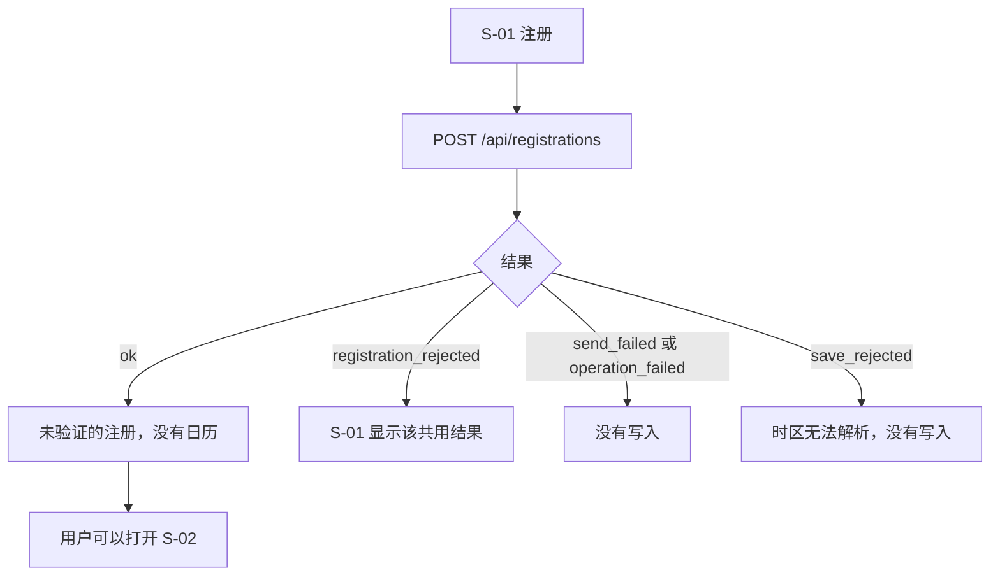
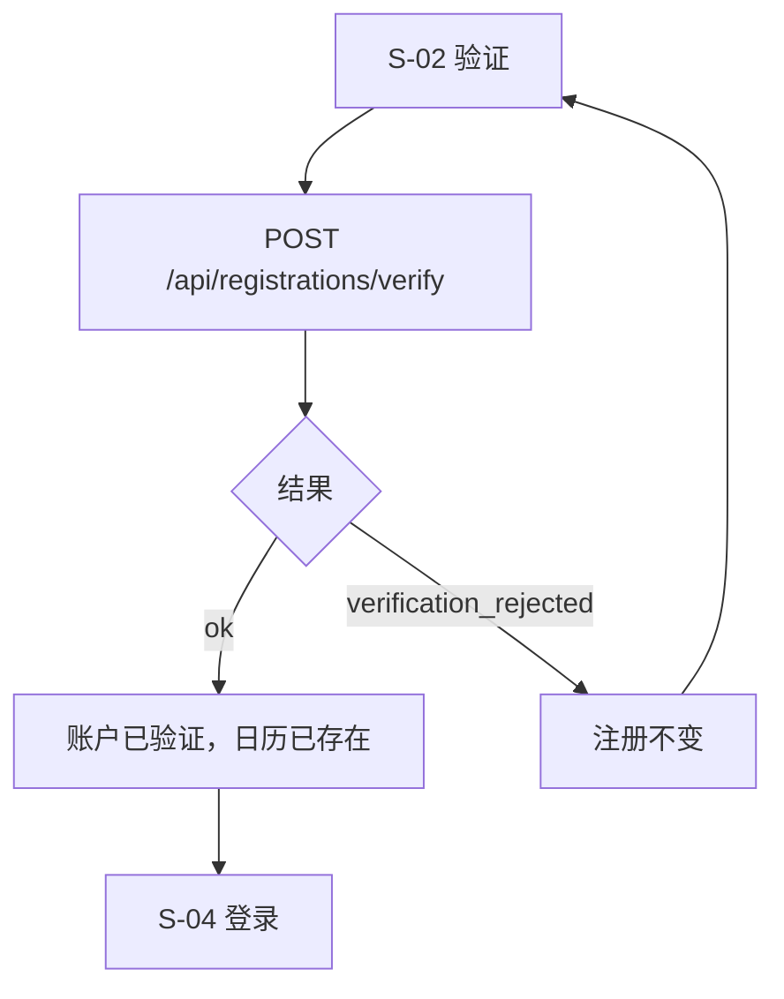
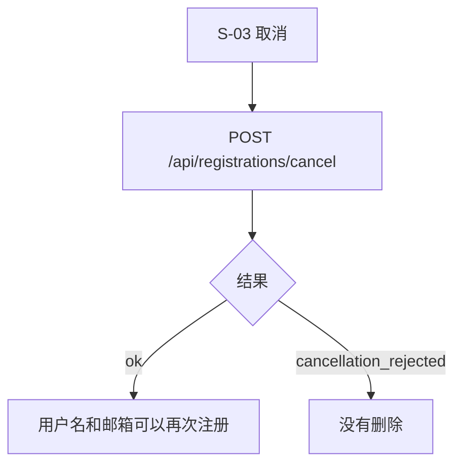
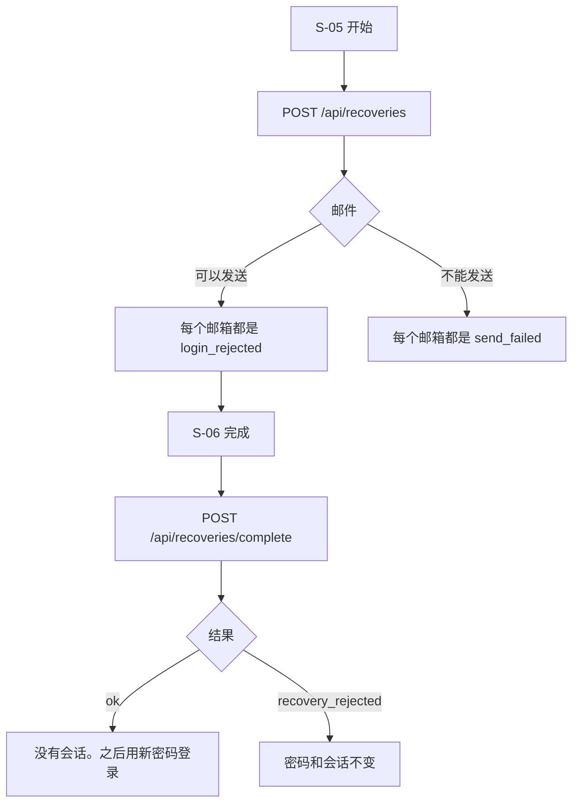
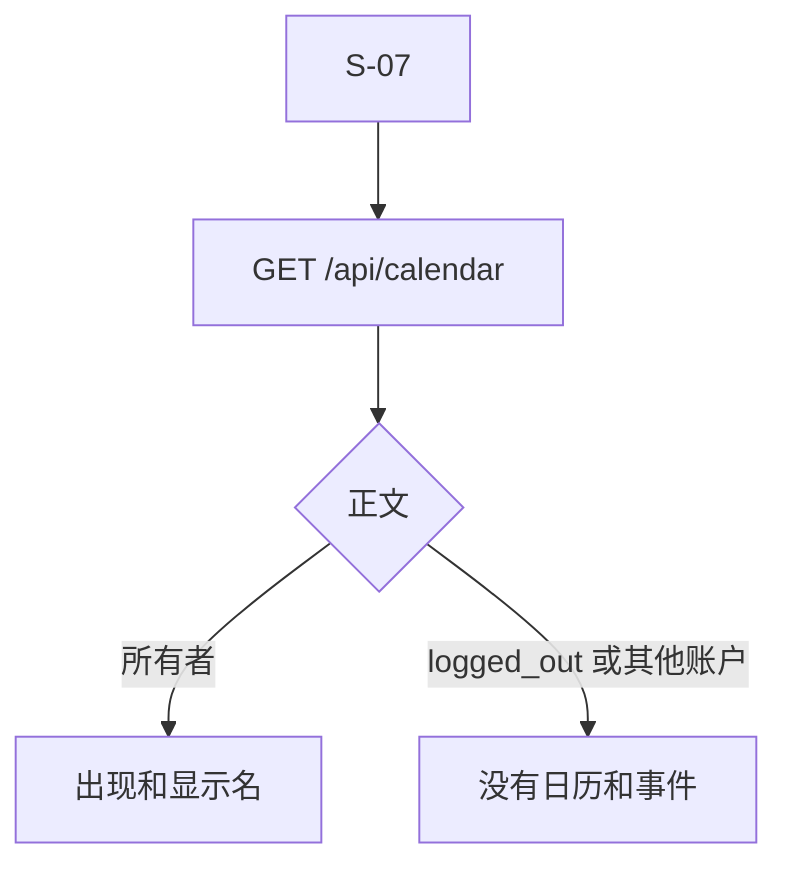
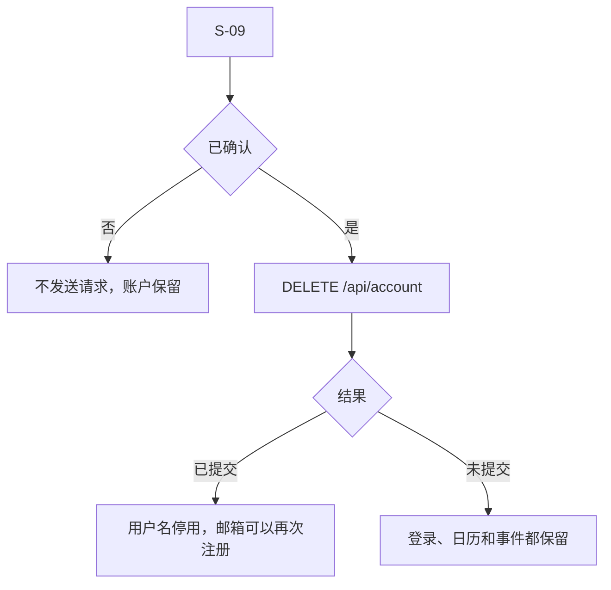

# 用户流程：个人时间

- 阶段：1 — 信息架构、用户流程和屏幕清单
- 日期：2026-11-25
- 状态：用户于 2026-11-25 随结构基线一并接受这些流程。它们不增加业务规则。这次接受不批准视觉方向、令牌、线框或应用代码。
- 依据：已批准的个人时间 PRD、已批准的技术设计，以及 `01-information-architecture.md`。
- 被拒绝的命令不改变已存储的行。页面显示该次请求返回的 `result`。它不计算第二个结果。
- 本文件不替换 `docs/ui-ux/02-user-flows.md`。英文文件是规范文本。

## F-01 注册

- 行为人：没有会话的人。
- 进入：S-01。
- 退出：一份未验证的注册并且没有会话，或者 S-01 保持不变。
- 页面发送用户名、邮箱、密码、可选昵称和浏览器的 IANA 名称。它不要求用户挑选时区。



追溯：BR-P3、BR-P4、BR-P11。AC-P01、AC-P02、AC-P17，空昵称的 AC-P33，内部空格的 AC-P39。页面不说明哪个字段被占用。

## F-02 验证

- 行为人：收到验证证明的人。
- 进入：S-02。不需要会话。
- 退出：服务器上有已验证账户及其个人日历，然后可见页面是 S-04。或者注册保持不变。页面不打开 S-07。



追溯：BR-P4。AC-P01。不匹配、已使用、未知或找回密码用的证明共用 `verification_rejected`。

## F-03 取消未验证的注册

- 行为人：没有会话的人。
- 进入：S-03。
- 退出：未验证的注册消失，或者什么都不改变。



追溯：BR-P4。AC-P24。未知邮箱、错误密码和已验证账户共用一个结果。若验证先完成，取消失败，账户保持已验证。若取消先完成，之后的验证不创建账户。页面显示它自己那次请求收到的结果。

## F-04 登录和退出

- 行为人：在 S-04 的人，或在 S-09 的所有者。
- 进入：S-04，或 S-09 上的退出。
- 退出：当前会话打开 S-07，或没有创建会话，或当前会话结束。

```mermaid
flowchart TD
  s04[S-04 登录] --> send[POST /api/sessions]
  send --> result{结果}
  result -->|ok| s07[S-07 自己的日历]
  result -->|login_rejected| out[没有会话，共用结果]
  s07 --> s09[S-09 退出]
  s09 --> end[DELETE /api/sessions/current]
  end --> next[下一次受保护请求是 logged_out]
```

追溯：BR-P2、BR-P4。AC-P01、AC-P25、AC-P34。未知邮箱、未验证注册和错误密码共用 `login_rejected`。退出只结束发出该请求的会话。同一账户的另一个会话保持打开。没有屏幕设置会话时长。

## F-05 找回密码

- 行为人：有会话或没有会话的人。完成找回不使用会话。
- 进入：S-05，然后 S-06。
- 退出：密码被替换，并且该账户的每个已打开会话都已结束，然后可见页面是 S-04。或者什么都不改变。不打开 S-07。



追溯：BR-P4。AC-P26、AC-P39。开始找回的结果不说明证明已发送。用最新的匹配证明完成时，结束该账户的每个已打开会话，包括正停在 S-08 的会话。尚未完成的保存不写入。完成之前已经完成的保存保留。更早的未使用证明随后以同一个 `recovery_rejected` 失败。

## F-06 查看所有者的日历

- 行为人：当前会话中的已验证所有者。
- 进入：登录后的 S-07，或从 S-08、S-09 返回。
- 退出：页面显示所请求 `from` 和 `to` 的正文，或者 `logged_out` 且没有日历和事件。



追溯：BR-P1、BR-P2、BR-P5、BR-P7。AC-P03、AC-P18、AC-P34。所有者看到公开和私密。其他人没有请求这个日历的页面。API 返回已结束的事件时，它们仍然显示。初始的 `from` 和 `to` 是 Q-04。

## F-07 保存事件

- 行为人：所有者。
- 进入：新建事件的 S-08，或已有的非重复事件或系列的 S-08。
- 退出：API 提交保存，或者什么都不写。`ok` 时 S-08 保持可见，并显示返回正文；正文包含冲突和继续句时也显示它们。然后由 Calendar 链接回到 S-07。取消则回到 S-07 并且不发送。

创建表单发送标题、开始、结束、地点、说明、可见性和一种重复类型。编辑表单发送同样的内容，但不发送另一种类型。新事件保持私密，除非保存前选择公开。地点和说明可以为空。去掉首尾空白后标题仍为空、缺少时钟时间，或结束不晚于开始，都是 `save_rejected`，已存储的事件不变。

不存在的当地时间不存储。当地时间出现两次时，只有保存中包含一个选定时刻才存储。点名的例子是 America/New_York 的 2026-03-08 02:30 和 2026-11-01 01:30。

并非每个月都存在的月日期返回带 `monthTypes` 和 `missingDates` 的 `save_rejected`。页面显示这些字段，不另做一份预览。正文这样标明时，系列保存显示 `continuesAfterWindow`。那句话不是冲突。`conflicts` 只显示标题、开始和结束。没有重叠时保存仍然成功；标志为真时，系列仍显示继续句。警告不阻止保存。页面不显示邮箱。

追溯：BR-P5、BR-P6、BR-P7、BR-P8、BR-P10、BR-P11。AC-P04、AC-P05、AC-P06、AC-P07、AC-P08、AC-P09、AC-P12、AC-P13、AC-P15、AC-P19、AC-P20、AC-P30、AC-P31、AC-P32、AC-P35、AC-P37、AC-P40。AC-P23 是 GAP-PT-01。AC-P35 是本页发出的那次保存的正文。哪一次保存最后完成，由 API 的结果决定。

## F-08 修改单次出现或系列

- 行为人：S-08 上的所有者。
- 进入：系列的一次出现，或系列本身。
- 退出：一个已分离的事件、一次缺席、一个被删除的系列，或原来的行。

修改单次出现，包括只改可见性，发送 `POST /api/events/:id/detach`，带上原始开始时刻和提交内容。系列不再发出该次出现。之后的系列保存或系列删除不改变已分离的事件。

删除单次出现发送 `DELETE /api/events/:id/occurrences`，带上原始开始时刻。页面不把该缺席显示为已取消事件。确认步骤上的取消不发送请求。

删除系列发送 `DELETE /api/events/:id`。仍附着的出现消失。已分离的事件保留。系列字段保存使用保存路由。页面自己不应用“已开始”和“未开始”的规则。它显示保存之后 S-07 收到的出现。

不提供改变重复类型的控件。如果仍然提交了类型变更，`save_rejected` 会让已存储的类型保持不变。

追溯：BR-P5、BR-P8、BR-P9。AC-P10、AC-P11、AC-P21、AC-P22、AC-P28、AC-P29、AC-P31。若系列保存先完成、分离后完成，已分离事件的内容是分离时提交的内容。页面显示它自己那次请求的结果。

## F-09 时区、跳过的日期和生成的选择

- 行为人：所有者。
- 进入：修改时区时为 S-09；返回的出现是 `choice_required` 或 `skipped` 时为 S-07。
- 退出：API 提交时区及其冻结，或者什么都不写。选择写入 `chosen_instant`，或者让它保持空。

S-09 把一个 IANA 名称发送到 `PATCH /api/account/timezone`。无法解析的名称是 `save_rejected`，并且不写入。S-07 在下一次日历正文里打印返回的 `start` 和 `end` 字符串。页面不从这些时刻另排一个时钟标签。与返回的 `start` 和 `end` 不同的时区时钟标签需要技术设计变更。本流程不做这个变更。

生成的开始不存在、结束不存在，或间隔跨过缺失的当地小时，显示为 `skipped`。生成的双起点显示为 `choice_required`，并带上返回的两个时刻。提交其中一个，就是把该公历日和该时刻发送到 `POST /api/events/:id/choices`。其他时刻不写入。选择之前，页面没有一段可当作冲突的已排程间隔。API 把选定的出现包含进来之后，S-07 显示返回的正文。

追溯：BR-P11。AC-P27、AC-P38。AC-P14 和 AC-P36 需要日历正文没有返回的时钟标签。手输时间的 AC-P15 属于 F-07。AC-P23 是 GAP-PT-01。

## F-10 昵称

- 行为人：S-09 上的所有者。
- 进入：昵称字段。
- 退出：已存储的昵称或没有昵称，以及下一次日历正文里的显示名。

去掉首尾空白后为空的值会清除昵称，显示名变为用户名。非空值去掉首尾空白后存储。内部空格保留。S-07 显示 API 返回的显示名，包括公开事件上的显示名，而不需要再次保存事件。

追溯：BR-P3。AC-P33、AC-P39。

## F-11 删除账户

- 行为人：S-09 上的所有者。
- 进入：删除动作，然后是它的确认步骤。
- 退出：登录、日历和事件都消失，或者三者都保留。



追溯：BR-P12。AC-P16。页面不提供部分删除。删除完成之后才结束的保存不写入，并可以显示 `account_gone`。先完成的保存会在删除随后完成时被去掉。页面显示它自己那次请求的结果。
