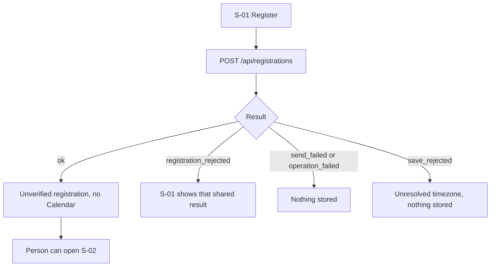
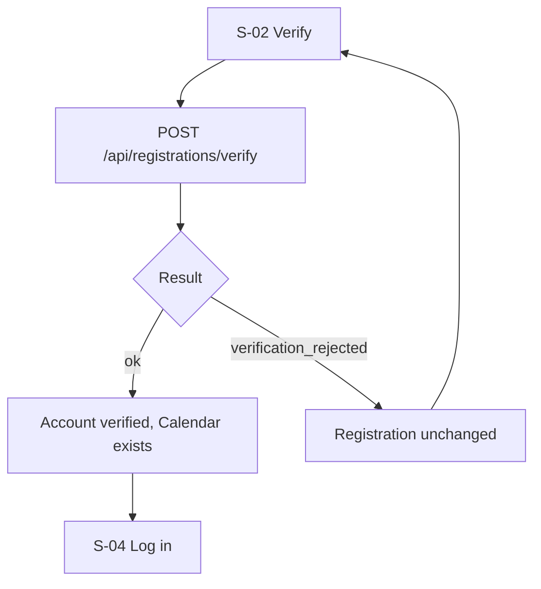
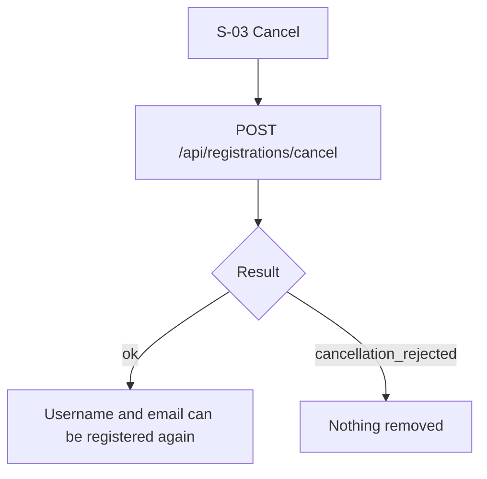
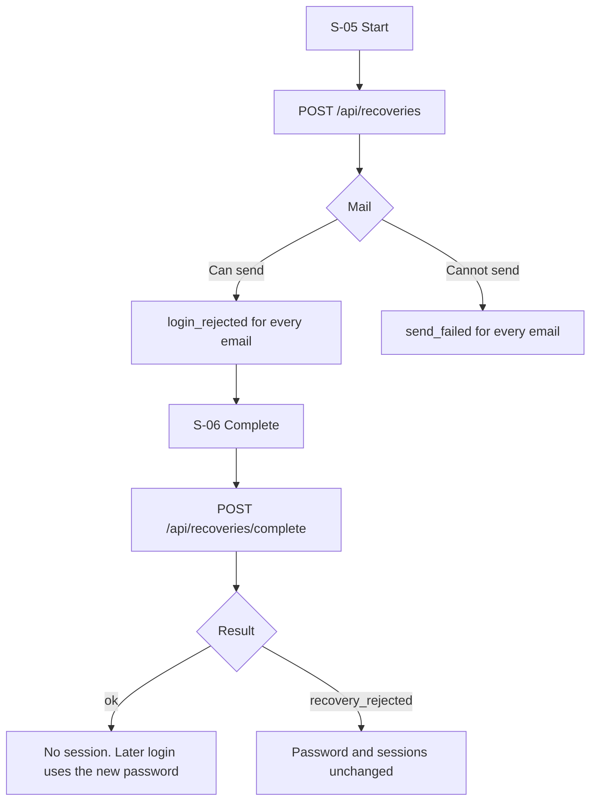
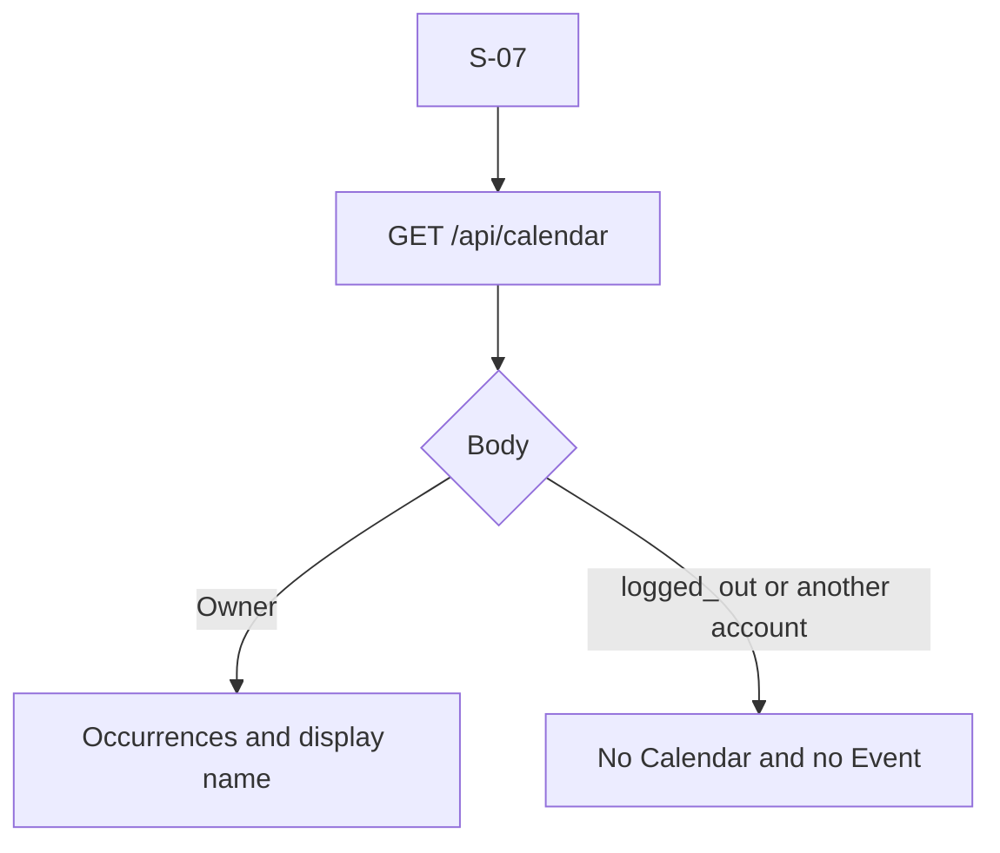
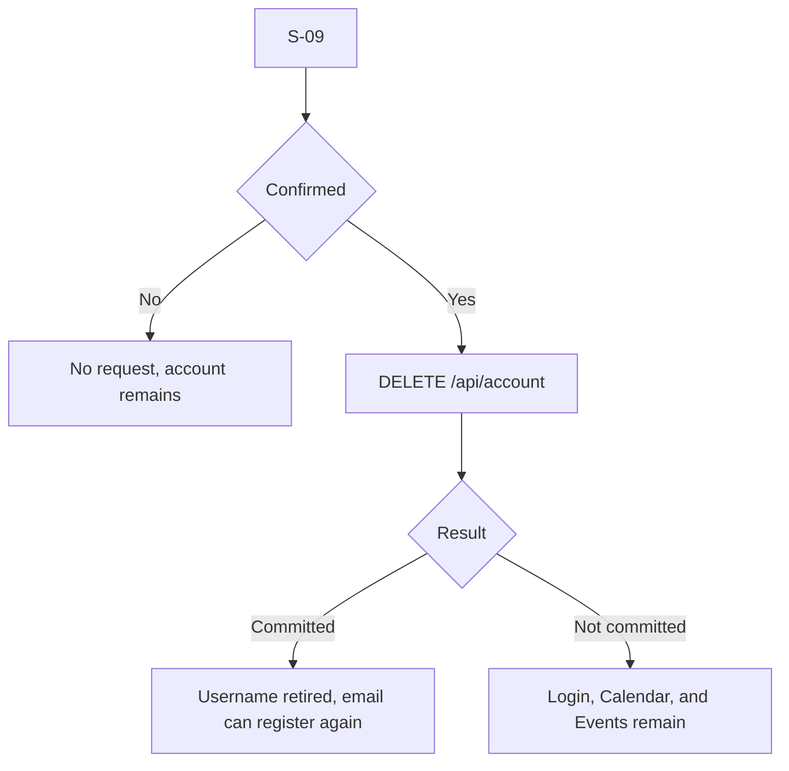

# User Flows: Personal Time

- Stage: 1 — Information Architecture, User Flows, and Screen Inventory
- Date: 2026-11-25
- Status: Accepted by the user on 2026-11-25 with the structural baseline. These flows add no business rule. This acceptance does not approve visual direction, tokens, wireframes, or application code.
- Authority: the approved personal-time PRD, the approved technical design, and `01-information-architecture.md`.
- A rejected command leaves the stored rows unchanged. The page shows the `result` returned to the request that was sent. It does not calculate a second result.
- This file does not replace `docs/ui-ux/02-user-flows.md`.

## F-01 Register

- Actor: a person with no session.
- Entry: S-01.
- Exit: an unverified registration and no session, or S-01 unchanged.
- The page sends username, email, password, the optional nickname, and the browser IANA name. It does not ask the person to pick a timezone.



Trace: BR-P3, BR-P4, BR-P11. AC-P01, AC-P02, AC-P17, AC-P33 for the empty nickname, AC-P39 for an internal space. The page does not say which field was taken.

## F-02 Verify

- Actor: the person who received the verification proof.
- Entry: S-02. No session is required.
- Exit: a verified account and its personal Calendar on the server, then the visible page is S-04. Or the registration is unchanged. The page does not open S-07.



Trace: BR-P4. AC-P01. A mismatched, reused, unknown, or recovery proof shares `verification_rejected`.

## F-03 Cancel an unverified registration

- Actor: a person with no session.
- Entry: S-03.
- Exit: the unverified registration is gone, or nothing changes.



Trace: BR-P4. AC-P24. Unknown email, wrong password, and a verified account share one result. If verification finishes first, cancellation fails and the account stays verified. If cancellation finishes first, a later verification creates no account. The page shows whichever result its own request received.

## F-04 Log in and log out

- Actor: a person at S-04, or the owner on S-09.
- Entry: S-04, or logout on S-09.
- Exit: this session opens S-07, or no session is created, or this session ends.

```mermaid
flowchart TD
  s04[S-04 Log in] --> send[POST /api/sessions]
  send --> result{Result}
  result -->|ok| s07[S-07 Own Calendar]
  result -->|login_rejected| out[No session, shared result]
  s07 --> s09[S-09 Log out]
  s09 --> end[DELETE /api/sessions/current]
  end --> next[Next guarded request is logged_out]
```

Trace: BR-P2, BR-P4. AC-P01, AC-P25, AC-P34. Unknown email, an unverified registration, and a wrong password share `login_rejected`. Logout ends only the session that sent it. Another session of the same account stays open. No screen sets a session length.

## F-05 Recover the password

- Actor: a person with or without a session. Completion does not use the session.
- Entry: S-05, then S-06.
- Exit: the password is replaced and every open session of that account has ended, then the visible page is S-04. Or nothing changes. S-07 does not open.



Trace: BR-P4. AC-P26, AC-P39. The start result does not say that a proof was sent. Completion with the newest matching proof ends every open session, including one that is on S-08. An unfinished save writes nothing. A save that finished before completion remains. An older unused proof then fails with the same `recovery_rejected`.

## F-06 See the owner's Calendar

- Actor: the verified owner in this session.
- Entry: S-07 after login, or a return from S-08 or S-09.
- Exit: the page shows the body for the requested `from` and `to`, or `logged_out` with no Calendar and no Event.



Trace: BR-P1, BR-P2, BR-P5, BR-P7. AC-P03, AC-P18, AC-P34. The owner sees public and private. Another person has no page that requests this Calendar. Ended Events remain when the API returns them. The initial `from` and `to` are Q-04.

## F-07 Save an Event

- Actor: the owner.
- Entry: S-08 for a new Event, or for an existing non-repeating Event or series.
- Exit: the API commits the save, or writes nothing. On `ok`, S-08 stays visible and shows the returned body, including conflicts and the continuation sentence when the body includes them. The Calendar link then returns to S-07. Cancel returns to S-07 and sends nothing.

The create form sends title, start, end, location, description, visibility, and one repetition kind. The edit form sends the same content except it does not send a different kind. A new Event stays private unless public is chosen before the save. Empty location and description may be sent. A title that is empty after trim, a missing clock time, or an end that is not after the start is `save_rejected` and leaves the stored Event unchanged.

An entered local time that does not exist is not stored. An entered local time that occurs twice is stored only when the save includes one chosen instant. The named cases are 02:30 on 2026-03-08 and 01:30 on 2026-11-01 in America/New_York.

A monthly date that does not exist in every month returns `save_rejected` with `monthTypes` and `missingDates`. The page shows those fields and does not build another preview. A series save shows `continuesAfterWindow` when the body says so. That sentence is not a conflict. `conflicts` shows title, start, and end only. No overlap still succeeds, and a series still shows the continuation sentence when the flag is true. The warning does not block the save. The page shows no email.

Trace: BR-P5, BR-P6, BR-P7, BR-P8, BR-P10, BR-P11. AC-P04, AC-P05, AC-P06, AC-P07, AC-P08, AC-P09, AC-P12, AC-P13, AC-P15, AC-P19, AC-P20, AC-P30, AC-P31, AC-P32, AC-P35, AC-P37, AC-P40. AC-P23 is GAP-PT-01. AC-P35 is the body of the save this page submitted. Which save finished last is the API's result.

## F-08 Change one occurrence or the series

- Actor: the owner on S-08.
- Entry: an occurrence of a series, or the series itself.
- Exit: one detached Event, one absence, a removed series, or the prior rows.

Changing one occurrence, including only its visibility, sends `POST /api/events/:id/detach` with the original start instant and the submitted content. The series no longer emits that occurrence. A later series save or series deletion does not change the detached Event.

Deleting one occurrence sends `DELETE /api/events/:id/occurrences` with the original start instant. The page does not show that absence as a cancelled Event. Cancel on the confirming step sends nothing.

Deleting the series sends `DELETE /api/events/:id`. Attached occurrences are gone. Detached Events remain. A series field save uses the save route. The page does not apply the started and unstarted rules itself. It shows the occurrences S-07 receives after the save.

A kind change is not offered. If a kind change is nevertheless submitted, `save_rejected` leaves the stored kind unchanged.

Trace: BR-P5, BR-P8, BR-P9. AC-P10, AC-P11, AC-P21, AC-P22, AC-P28, AC-P29, AC-P31. When a series save finishes first and the detachment finishes later, the detached Event has the content submitted with the detachment. The page shows the result of the request it sent.

## F-09 Timezone, skipped dates, and a generated choice

- Actor: the owner.
- Entry: S-09 for a timezone change, or S-07 when a returned occurrence is `choice_required` or `skipped`.
- Exit: the API commits the timezone and its freezes, or writes nothing. A choice sets `chosen_instant`, or leaves it null.

S-09 sends one IANA name to `PATCH /api/account/timezone`. An unresolved name is `save_rejected` and writes nothing. S-07 prints the returned `start` and `end` strings in the next Calendar body. The page does not format a separate clock label from those instants. A timezone clock label distinct from the returned `start` and `end` needs a Technical Design change. This flow does not make that change.

A generated missing start, missing end, or gap across a missing hour is shown as `skipped`. A generated doubled start is shown as `choice_required` with the two returned instants. Submitting one of them sends that civil date and that instant to `POST /api/events/:id/choices`. Any other instant writes nothing. Before the choice, the page has no scheduled interval to treat as a conflict. After the API includes the chosen occurrence, S-07 shows that returned body.

Trace: BR-P11. AC-P27, AC-P38. AC-P14 and AC-P36 need a clock label the Calendar body does not return. AC-P15 for an entered time is F-07. AC-P23 is GAP-PT-01.

## F-10 Nickname

- Actor: the owner on S-09.
- Entry: the nickname field.
- Exit: the stored nickname or no nickname, and the display name on the next Calendar body.

A value that is empty after outer trim clears the nickname, and the display name is the username. A non-empty value is stored without outer whitespace. Internal spaces remain. S-07 shows the display name the API returns, including on a public Event, without another Event save.

Trace: BR-P3. AC-P33, AC-P39.

## F-11 Delete the account

- Actor: the owner on S-09.
- Entry: the delete action, then its confirming step.
- Exit: the login, Calendar, and Events are gone, or all of them remain.



Trace: BR-P12. AC-P16. The page does not offer a partial delete. A save that finishes after a completed deletion writes nothing and can show `account_gone`. A save that finished first is removed when deletion then completes. The page shows the result of the request it sent.
